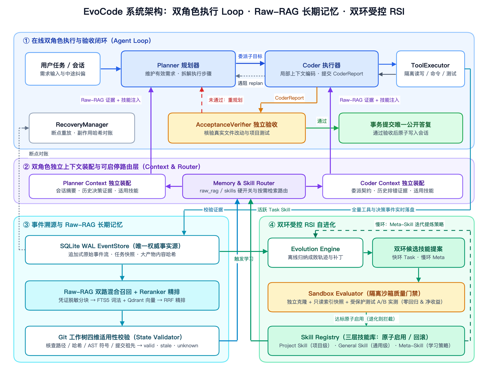
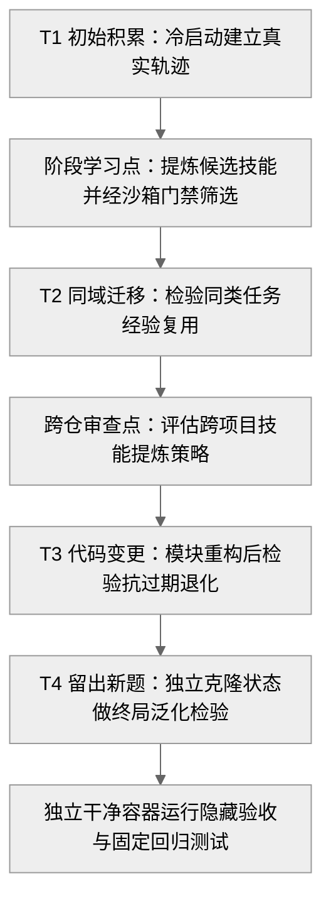

# EvoCode

具备 **混合长期记忆（Raw-RAG）** 与 **门禁受控双环技能自进化（RSI）** 的可恢复双角色 Coding Agent。

> 📖 **核心文档直达**：[**系统架构详解 (`docs/architecture.md`)**](docs/architecture.md) ｜ [**Benchmark 评测设计 (`docs/benchmark-design.md`)**](docs/benchmark-design.md) ｜ [**Benchmark 评测结果与图表 (`docs/benchmark-results.md`)**](docs/benchmark-results.md)

---

## 1. 项目架构

EvoCode 由 **在线双角色执行与验收闭环（Agent Loop）**、**双角色独立上下文与可启停路由层**、**SQLite WAL 事件溯源与 Raw-RAG 长期记忆** 以及 **快慢双环受控 RSI 自进化** 四部分组成：



- **在线双角色验收闭环（Agent Loop）**：`Planner` 维护有效需求并拆解步骤，`Coder` 在隔离工作区编码自测并提交 `CoderReport`（遇阻可触发 `replan`）；`AcceptanceVerifier` 独立核验真实改动与测试，未通过打回重规划，异常中断由 `RecoveryManager` 对账恢复。
- **Raw-RAG 混合长期记忆（双向赋能 `Planner` 与 `Coder`）**：全量事件落盘 `SQLite WAL EventStore`，经 `FTS5` 词法 + `Qdrant` 向量召回、`Reranker` 精排及 Git 工作树四维适用性校验（`valid / stale / unknown`），由路由层按需注入 **`Planner`（跨会话规划与历史契约对齐）** 与 **`Coder`（历史报错与补丁参考）**。
- **双环受控 RSI 自进化**：离线 `Evolution Engine` 从轨迹提炼快环 **`Task Skill`（项目/通用经验，注入 `Planner` 与 `Coder`）** 与慢环 **`Meta-Skill`（迭代学习策略本身）**，所有候选须通过 `Sandbox Evaluator` 受保护验收测试 A/B 实测（零回归且净收益）后方可原子启用。

👉 详细模块边界、断点恢复对账、历史证据四维校验与双环演化流程见：[**系统架构详解 (`docs/architecture.md`)**](docs/architecture.md)

---

## 2. Benchmark 设计思路

针对传统单题孤立评测无法检验“跨任务记忆复用”与“持续自进化净收益”的问题，本项目构建了 **3 个独立 Python 业务仓库（`repo_api` / `repo_cli` / `repo_data`）× 4 个时序演化阶段 = 12 道真实修复任务（共 54 次主实验运行 + 8 个独立门禁审计候选）** 的评测基准：



| 实验分组 | 对照维度 | Raw-RAG 记忆 | 技能库与自进化机制 | 计分范围 |
| :--- | :--- | :---: | :--- | :---: |
| **A1** | 实验 A：检索关闭基线 | 关闭 | 关闭技能与自进化（共享只读公共历史） | `T2–T4`（9 题） |
| **A2** | 实验 A：开启混合记忆 | **开启** | 关闭技能与自进化（共享只读公共历史） | `T2–T4`（9 题） |
| **B2** | 实验 B：静态技能基线 | 开启 | 初始空任务技能库 + 默认学习策略，不触发学习 | `T1–T4`（12 题） |
| **B3** | 实验 B：一阶任务级演化 | 开启 | 开启 `Task Skill` 提炼与沙箱门禁，固定学习策略 | `T1–T4`（12 题） |
| **B4** | 实验 B：完整双环自进化 | 开启 | 开启 `Task Skill` + 跨仓 `Meta-Skill` 审查与门禁 | `T1–T4`（12 题） |

👉 四阶段任务链设计、防泄漏物理隔离机制与 `5 + 1` 核心评价指标定义见：[**Benchmark 评测设计 (`docs/benchmark-design.md`)**](docs/benchmark-design.md)

---

## 3. Benchmark 评测结果

全部 54 个主实验运行位 **100% 完成独立容器核验（零缺测）**，全实验 **历史回归率 `0.0%`（0/54）**；独立门禁审计集 **无增益技能拦截率 `NSRR = 83.3%`（5/6，其中 4 个有害/过期技能 `100%` 拦截）**。

### 核心指标汇总表

| 实验组 | 任务解决率 (`Pass@1`) | `T3` 代码变更解决率 | 技能迁移成功率 (`T2+T4` / `T3+T4`) | 已解题工具步数 (`Tool Calls`) | 全链路摊销成本 (`Total Tokens`/解) | 同题配对净变化 (`Paired-Solved Cost`) | 历史回归率 (`Regression`) |
| :--- | :---: | :---: | :---: | :---: | :---: | :--- | :---: |
| **A1（无检索）** | 8/9（88.9%） | 66.7%（2/3） | — | **38.6 步** | **48.7 万** | 对照基线（7 题共同成功） | **0.0%** |
| **A2（Raw-RAG）** | 8/9（88.9%） | **100.0%（3/3）** | — | 41.9 步 | 62.8 万 | `T3` 阶段 `+33.3%`；全任务摊销 `-1.4` 步 | **0.0%** |
| **B2（静态基线）** | 10/12（83.3%） | 66.7%（2/3） | 100.0% / 83.3% | 39.2 步 | 63.92 万 | 对照基线（10 题共同成功） | **0.0%** |
| **B3（任务级 RSI）** | 9/12（75.0%） | 66.7%（2/3） | 83.3% / 83.3% | 37.8 步 | 64.93 万 | 门禁拦截唯一退化候选（`0` 启用，线上零污染） | **0.0%** |
| **B4（完整 RSI）** | **11/12（91.7%）** | **100.0%（3/3）** | **100.0% / 100.0%** | 38.2 步 | **63.87 万** | **-1.9 步 / -5.7% 在线 Token**（较 B2） | **0.0%** |

- **Raw-RAG 抗代码变更验证**：`A2` 在接口重构与契约迁移最剧烈的 `T3` 阶段达成 **`100.0%` 解决率（较 `A1` +33.3%）**；在账务精度迁移难题上，开启 Raw-RAG 的四组（`A2/B2/B3/B4`）`4/4` 全部通过，唯独关闭检索的 `A1` 因丢失历史精度契约失败。
- **RSI 自进化提效降本验证**：`B4` 在 `T1` 后提炼启用结算精度技能（沙箱实测 `52 → 14` 步，`-73.1%`），后续阶段自动注入 `92` 次并实现 **`T2–T4` 连续 9 题 100% 全胜**；在 10 道同题上平均少用 `1.9` 步、省 `5.7%` 在线 Token，**含后台学习在内的每解总摊销 Token（`63.87 万`）低于不学习的静态基线 `B2`（`63.92 万`）**。
- **质量门禁防退化验证**：门禁在 `B3` 中当场拦截步数恶化（`28 → 45` 步）的候选技能防止污染，并在独立盲测审计集实现 **`NSRR = 83.3%`（`4/4` 有害/过期技能 `100%` 拦截）**。

👉 时序演化折线图、RSI 三组与门禁实测柱状图及因果证据链见：[**Benchmark 评测结果与能力验证 (`docs/benchmark-results.md`)**](docs/benchmark-results.md)

---

## 4. 快速开始

需准备 Python 3.12+、[uv](https://docs.astral.sh/uv/) 及 Docker：

```bash
# 1. 安装依赖与初始化本地配置
uv venv --python 3.12 && uv pip install -e '.[dev]'
cp config/default.yaml config/local.yaml
cp .env.example .env

# 2. 启动本地 Web 工作台（默认监听 http://127.0.0.1:8787）
.venv/bin/python scripts/evocode_service.py start --build

# 3. 通过 CLI 运行代码修复任务
.venv/bin/evocode task run --repo /path/to/repo --prompt "修复问题并补充验证" --acceptance "pytest -q"

# 4. 运行核心单元测试与 Benchmark 套件测试
.venv/bin/python -m pytest -q
.venv/bin/python -m pytest benchmark/tests -q
```
