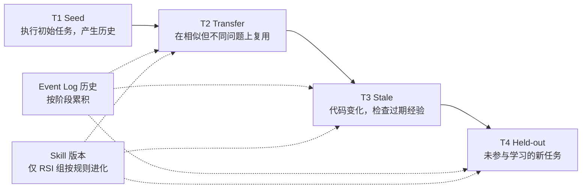
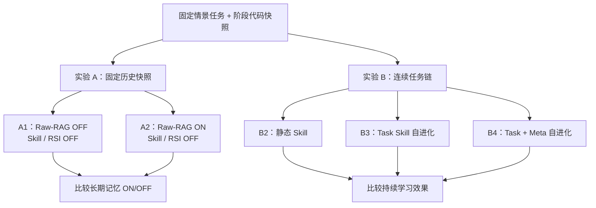
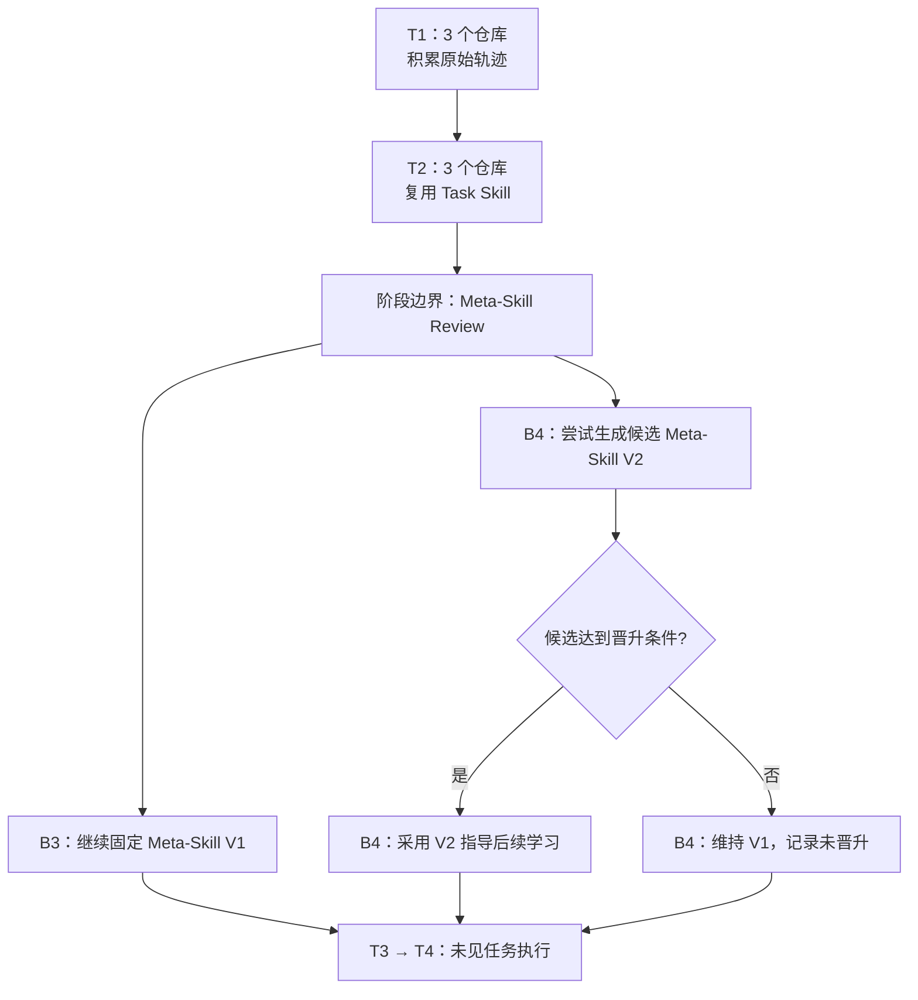
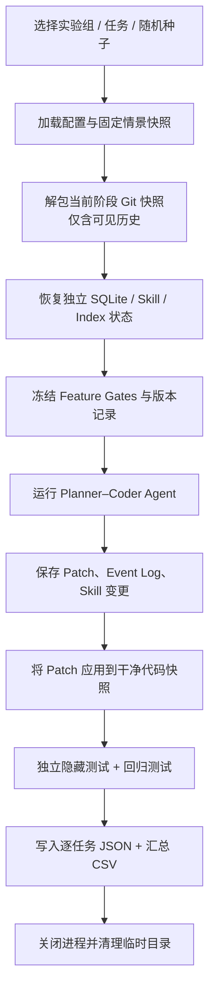
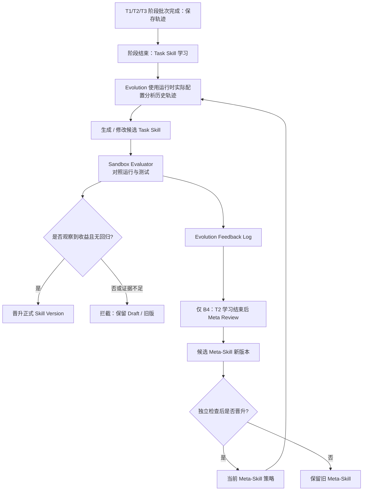

# EvoCode Benchmark：Raw-RAG 长期记忆与 RSI Skill 自进化评测方案

> **文档用途：** 解释 Benchmark 设计思路；执行依据为 [冻结协议与单项目四阶段端到端闭环](frozen_protocol.md)，协议于 2026-11-06 冻结，当前执行修订为 `evocode-benchmark-2026-11-06-r2`（阶段屏障并发调度 `phase_barrier`）。<br>
> **确认的评测范围：** 12 个时序任务、两套实验、5 项核心指标 + 1 项 Skill 质量门禁指标；单次正式运行（`repeats=1, seed=42`）共 54 个主任务执行位置。<br>
> **当前模型配置：** 协议基准 Planner / Coder 为 `qwen3.8-flash`，Agent 配置的 Context 窗口保持 131,072 Token；Evolution 与运行时实际连接的 Planner/Coder 模型以环境变量/运行配置为准，并在批次清单中强制记录真实 `actual_model_ids`。<br>
> **文件位置：** Benchmark 实现、题集、配置与产物放在 EvoCode 仓库根目录的 `benchmark/`，与 `src/` 同级。
> **结果声明：** 本文只定义评测方法，不预设 Raw-RAG 或 RSI 一定提升。12 题属于有限任务范围的工程评测，不足以单独支持广泛的统计显著性或工业级泛化结论。

---

## 1. 目标和评测原则

研究两个独立问题：

1. **Raw-RAG 是否有用？** 在相同历史、代码和模型条件下，打开长期原始证据检索是否提高编程任务完成率或降低执行成本？
2. **RSI 是否有用？** 保持 Raw-RAG 开启，自动 Task Skill 学习和 Meta-Skill 自进化是否逐步改善后续任务表现？系统能否拦下无明显收益或存在回归的候选 Skill？

**最小实施原则：**

- 用**固定可执行情景快照**代替必须下载的真实 GitHub 项目；仍然让 Agent 真实读取、修改、运行 Python 代码。**每个情景使用本地 Git 历史（不要求真实 GitHub 仓库）**，保证 T3 的 `state_validator` 有可靠版本依据。
- 用**时序任务链**测记忆积累与迁移；每个阶段有预设代码版本，历史与 Skill 可依规则继承。
- **只有实验 A 切换 Raw-RAG 开关**；实验 B 全部保持 Raw-RAG ON。
- 评分以**隔离的隐藏测试与回归测试**为准，不使用 LLM 自评作为最终成功依据。
- 同一组的历史、Skill、Evolution 数据独立保存，不允许组间串用；记录每次实际功能开关和 Skill 版本。
- 当前任务说明与公开检查供各组正常求解；未来题目、主测隐藏测试、参考修复与私有判分日志不得进入 Agent 可访问的长期记忆、Skill 提炼输入或 Context。

---

## 2. 图 1：时序任务链与继承关系



**数据集规模：** 3 个彼此独立的小型 Python 项目 × 4 个阶段 = **12 个任务**；固定为 API 业务模块、CLI 工具、数据处理模块。先完成 API 项目的四阶段工程闭环，再按相同契约完成其余项目；这是同一 Benchmark 的实施顺序。

| 阶段 | 任务设计 | 主要检验的能力 | 关键约束 |
|---|---|---|---|
| T1 Seed | 初始隐蔽 Bug、配置错误或重复出现的开发问题 | 产生真实执行轨迹与后续可复用经验 | 禁止把标准修复直接写入 Memory |
| T2 Transfer | 同机制、不同文件或不同模块的相似任务 | Raw-RAG 记忆复用、Task Skill 迁移 | 题目不能只是复制 T1 答案 |
| T3 Stale | 预设重构后出现相似错误：函数改名、接口变化或依赖升级 | 历史证据状态校验、避免照抄过期修复 | 清晰标明阶段代码版本 |
| T4 Held-out | 与前面相关但细节未知的新任务 | 后续新任务的迁移能力 | **不参与之前的 Skill/Meta-Skill 提炼或选择** |

**固定快照不等于纯文字题。** 每个任务必须有可运行的 Python 代码、目标描述与可信的私有测试。**所有时序情景必须具备本地 Git 历史**，并为 T1/T2/T3/T4 保存对应阶段的 HEAD 和可见祖先提交，便于验证 `commit_sha`、路径、符号及代码变化；无需依赖线上真实仓库。

**阶段继承规则：**

- 每个阶段**代码起点固定**（避免 T1 的偶发成功或失败改变 T2 的代码难度）。
- `Event Log` 沿着**同一实验运行**按时间积累，但不得提前注入 T4 信息。
- B3/B4 在 T1/T2/T3 阶段批次结束后各触发一次学习，通过门禁的 Skill 用于后续阶段；B2 Skill 永远固定。同阶段内的任务使用阶段开始时的历史截止边界与 Skill 版本。
- 为保证版本可追溯，所有情景阶段设置稳定 `repository_id`、`stage_id`、`code_snapshot_hash`、`visible_head_sha`、`allowed_ancestor_shas`；**同一任务链使用可追溯的本地 Git 演化历史，不作为可选项**。历史 Event 内的 `git_commit` 必须能映射到对应的已发生版本。
- **未来信息隔离：** T1 运行时的 `.git` 只能包含截至 T1 的历史；T2 才开放 T2 允许的历史，以此类推。不能把 T1—T4 全部未来 Commit 预先塞入 Agent 可访问的 Bare Repo/Worktree，因为即使不在当前分支，仍可能通过 `git show`、其他 ref、甚至对象库扫描读到未来代码。
- **版本检查口径：** 不同 Commit 只说明环境发生过变化，不直接判定 `stale`；需同时核对相应文件、符号或依赖是否真的已失效。
- 若需要单独评测 Raw-RAG（实验 A），不使用各组自己产生的不同训练历史，而使用**相同冻结历史快照**。

---

## 3. 实验配置：两套实验、五个组

### 3.1 实验 A：Raw-RAG 开关消融

| 组别 | Raw-RAG | Task Skill | Evolution | 比较目的 |
|---|---|---|---|---|
| **A1 Baseline** | OFF | OFF | OFF | 无长期检索基线 |
| **A2 Raw-RAG** | ON | OFF | OFF | 原始历史检索的独立增量 |

**控制变量：** A1/A2 必须使用同一题目、同一代码快照、同一历史 Event Log 快照、相同 Planner/Coder 模型与提示词、相同执行限制。A1 不应通过旧缓存、`memory.search`、Skill 或历史摘要旁路取得 Raw-RAG 长期证据；但保留正常当前会话 Context、Task State 与事件写入。

**运行方式：** 公共收集流程使用真实 Agent，开启 Raw-RAG、关闭 Skill/Evolution，按 T1→T2→T3 阶段顺序执行；在 `formal_benchmark`（`phase_barrier`）下，每阶段的三个仓库（`repo_api, repo_cli, repo_data`）作为并发波次执行，全部终止后按固定顺序归并历史并执行增量索引，保留成功与失败轨迹。T2—T4 分别使用截至此前阶段的同一份冻结历史，每个仓库的 A1/A2 作为同步配对各自克隆独立状态（每阶段最多 3 个配对、6 个独立臂并发派发）。T1 不计入实验 A 主成绩。公共收集不使用主测私有评分作为学习反馈；索引在主测前同步完成。

### 3.2 实验 B：RSI 持续学习（Raw-RAG 始终 ON）

| 组别 | Raw-RAG | Skill | Evolution | 要回答的问题 |
|---|---|---|---|---|
| **B2 静态 Skill** | ON | 固定初始 Skill | OFF | 有现成 Skill、但不学习的基线 |
| **B3 Task RSI** | ON | Task Skill 随任务演进 | ON，固定 Meta-Skill V1 | Task Skill 自动学习是否有效 |
| **B4 Meta-RSI** | ON | Task Skill 随任务演进 | ON，允许 Meta-Skill 更新 | 学习方法自进化是否带来额外效果 |

**B2、B3、B4 从完全一致的初始 Event Log / Skill Registry / Meta-Skill V1 开始。** 三组执行相同的阶段顺序，但独立积累各自的运行历史。比较 B3−B2 体现 Task RSI 系统整体效果；比较 B4−B3 体现 Meta-Skill 可进化的增量。

**B4 的阶段绑定 Meta Review（固定规则）：**

1. **统一阶段屏障顺序（`phase_barrier`）：** 对 B2/B3/B4 全部采用 `3 个仓库的 T1 波次 → 阶段屏障与学习批次 → 3 个仓库的 T2 波次 → 阶段屏障、Task 学习与 B4 Meta Review → 3 个仓库的 T3 波次 → 阶段屏障与学习批次 → 3 个仓库的 T4 独立克隆波次`。同一阶段波次内三个仓库并发执行（同组共享单个 `Application`/`EventStore`，按 `repository_id` 与独立工作区隔离），主任务全部终止后才进入增量索引、并发生成三仓库各自的 `project` 作用域候选 Skill、并发执行 Gate 评估，并按 `repo_api → repo_cli → repo_data` 固定顺序发布，确保 Meta Review 严格发生在六个主任务及 T2 全部三仓库 Task Skill 门禁落盘之后。
2. **固定审查点：** 当三个仓库的 T2 都结束、T2 Task Skill 学习完成时，B4 **强制触发一次 `Meta-Skill Review`**，无论生产环境的 `meta_review_after_runs` 是否达到阈值；这属于 Benchmark 专用调度，不修改生产配置。B3 同样记录这个阶段边界，但始终保持 Meta-Skill V1 不变。
3. **固定初始状态：** B2/B3/B4 使用相同、可追溯的初始状态，不额外加入外部 Evolution 预热资料；禁止临时引入有利于某组的反馈。
4. **只强制 Review，不强制晋升：** B4 可以提出 V2 候选，但只有满足既定晋升规则才更新。若没有有效新版本，保持 V1，**如实标记 `meta_review_triggered=true`、`meta_skill_promoted=false`**；不能伪造 RSI 增益。
5. **只影响未来：** T1/T2 的历史可用于这一时刻的策略复盘；获准生效的新 Meta-Skill 仅指导 **T2 之后** 的学习，不得提前读取 T3/T4 信息，更不能回写已经提交的旧任务成绩。

新 Meta-Skill 通过 T3 后的 Task Skill 学习产生下游影响，T4 是主要观察位置。需要保留“Meta 版本→T3 后学习批次→派生 Task Skill→T4 真实模型上下文”的证据链；Meta Gate 临时派生的 Skill 不直接写入主任务正式库。三个 T4 分别从同一组冻结快照克隆，不相互继承事件或技能。

这个设计可以保证 **B4 一定发生 Meta-Skill 审查**，但不保证 V2 晋升或性能提升。若没有版本晋升，B4−B3 无法解释为 Meta-Skill 新策略带来的提升，应明确将其报告为“无有效进化/未形成可比较的新策略”。

### 3.3 图 2：两套实验在时间线上的关系



### 3.4 图 3：B4 的阶段触发与后续学习



**注意：** 此图中两组的“进入 T3/T4”表示分别进入各自独立的试验环境，不是合并 Event Log 或 Skill Registry。B2 仍按同一阶段时间线执行，但保持静态 Skill。Review 不允许看到未来题目内容或隐藏测试。

---

## 4. 核心指标：5 项 + 1 项 Skill 门禁指标

对外报告与简历优先展示**任务成功率、成本、Skill 迁移和无效 Skill 拦截**。其余作为自动化日志保留，不必全部写进简历。

| 指标 | 定义/计算口径 | 用于什么 |
|---|---|---|
| **1. Pass@1 / Solve Rate** | 单次任务运行后，**私有修复测试及回归测试全部通过**的任务数 / 有效判分数；同时报告成功数 / 计划数与覆盖率 | **主指标**：实际编程任务能否完成 |
| **2. Tool Calls per Solved Task** | 成功任务的 Agent 工具调用总量 / 成功任务数 | 衡量完成任务的操作效率；同时报告成功任务数，避免只比较少量成功样本 |
| **3. Total Tokens per Solved Task** | 成功任务消耗的全部 LLM Token / 成功任务数；Planner、Coder 分项记录，RSI 另记 Evolution Token | 衡量推理与学习成本，明确在线成本与离线学习成本口径 |
| **4. Skill Transfer Success** | 后续未参与 Skill 生成的迁移任务中，通过私有测试的比例（可与 B2 比较） | Skill 是否真正能用于新问题 |
| **5. Regression Rate** | 在固定回归任务集合中，旧 Skill 能通过而新 Skill 不能通过的任务数 / 旧 Skill 能通过的任务数 | Skill 更新是否导致能力退化 |
| **6. Non-Improving Skill Rejection Rate（NSRR，无增益 Skill 拦截率）** | 独立评估认定为**未观察到提升或有回归**的候选 Skill 中，被正式发布门禁拒绝或保留在草稿态的比例 | 体现 RSI 能否防止无收益 Skill 污染正式库 |

### 4.1 NSRR 的正确计算

\[
\mathrm{NSRR}=\frac{\#\{\text{独立判定无增益的候选，且被 Gate 拦截}\}}{\#\{\text{独立判定无增益的候选}\}}\times100\%
\]

- **无增益并不等于确定有害。** 可分 `no_demonstrated_gain`（未见明显提升）和 `harmful`（回归或失败）。两种候选都可以先不晋升，但要在原始日志中保留区分。
- **不能使用 Gate 自己的结果定义“无增益”，再用同一结果证明 Gate 拦截准确。** 需有与 Gate 使用的测试数据隔离的独立测试或预先定义的候选标签。
- 固定准备八个候选 Skill 检查位置：重复、过期、潜在回归、潜在有益各两个。类型不等于有效性标签，最终由独立检查结果标注，证据不足记 unknown。此检查集独立于 12 个 Coding Task 的主成功率统计。
- **只拦不放**也能得到高 NSRR，所以还应在报告附注**确有增益的 Skill 是否能被晋升**（作为案例与原始计数，不必增加第 7 个核心指标）。
- 若没有出现无增益候选，指标记为 `N/A`，**不能写成 100%**。如果只有 2 个无增益候选被拦下，也只能报告 `2/2`，不能夸大为通用能力。

**建议用于简历的准确表述：** “构建基于隔离执行反馈的 Skill 晋升门禁；在 N 个已独立标注的无增益/有害候选中拦截 K 个，降低无效 Skill 进入正式库的风险。”在跑出实际结果之前不写百分比或提升结论。

### 4.2 几个指标的口径注意

- **Pass@1：** 对随机 Agent，一次运行成功率属于单次尝试的经验估计；如重复运行，报告每组的独立试验次数与平均值，不应把多次尝试误当一次 Pass@1。
- **Tool Calls / Tokens per Solved Task：** 这两个数只对成功样本求平均，可能出现“成功率低、幸存者成本低”的误导；和 Solve Rate 一起看，且统计所有任务（包括失败）的总消耗用于内部排查。
- **Paired-Solved Cost（配对成功题成本，补充统计口径，不是第 7 项指标）：** 对同一批题目的两组结果，取“双方都成功的任务交集”，仅在此集合上分别计算平均 Tool Calls 和 Tokens。例如 A1/A2 共同完成 4 题时，报告这 4 题各自的两组平均成本及差值。**这能使被比较的题目完全一致，但交集可能偏向较容易的题**，不能据此代替整体成功率和全任务总成本；如交集为空，报告 `N/A`。
- **Token：** 建议分别记录 `planner_tokens`、`coder_tokens`、`evolution_tokens`，对 RSI 同时提供在线执行与包含学习开销的成本。不要只记 Coder。
- **Regression Rate：** 需要固定**同一批回归任务**在旧版与新版 Skill 下重新执行，不能直接用 T1 和 T4 成功率相减代替。
- **Skill Transfer：** 至少 T2 和 T4 应是未参与生成该版本 Skill 的任务；特别是 T4 完全隔离。

### 4.3 配对成本与完整开销

对每一组对照，固定使用双方均成功的题目交集比较同题成本，同时报告各组 Solve Rate、所有任务的总消耗，以及失败任务开销。交集为空时记为 N/A，不用不同题目上的成功成本代替配对结果。

含学习成本的报告另给出整个实验批次总开销与主任务成功数，不把公共学习、Meta 或门禁开销任意归到某一道成功题。未知用量记为未知，不能补零。

---

## 5. 场景快照与任务文件规范

Benchmark 文件固定放在仓库根目录的 `benchmark/`。Agent 只看到当前任务工作区；隐藏测试、参考修复、发布门禁题及独立审计题放在该目录的 `private/` 中，由不同受控流程使用。

```text
repository/
├── src/                       # EvoCode Agent 通用实现
└── benchmark/                 # Benchmark 实现、题集、配置与产物
    ├── scenarios/             # repo_api、repo_cli、repo_data 各四阶段
    ├── private/
    │   ├── acceptance/
    │   ├── regression/
    │   ├── references/
    │   ├── gate_selection/
    │   └── gate_audit/
    ├── git_stage_packages/
    ├── seeds/
    ├── gate_cases/
    ├── configs/protocol.yaml
    ├── runner/
    ├── scripts/
    ├── tests/
    ├── results/
    ├── reports/
    └── .runtime/
```

详细目录职责见冻结协议；目录排列本身不提供访问隔离。Agent 容器不能挂载整个项目或 Benchmark 根目录。

**场景 `manifest.json` 最小字段示例（实际落盘为 JSON，全局协议 `configs/protocol.yaml` 为 YAML）：**

```json
{
  "task_id": "repo_api_t3",
  "chain_id": "repo_api",
  "stage": "stale",
  "repository_id": "repo_api",
  "code_dir": "scenarios/repo_api/t3_stale/code",
  "code_snapshot_sha256": "REPLACE_WITH_REAL_HASH",
  "visible_head_sha": "REPLACE_WITH_STAGE_GIT_HEAD",
  "allowed_ancestor_shas": ["REPLACE_WITH_PRIOR_ALLOWED_COMMIT"],
  "git_stage_package": "git_stage_packages/repo_api/t3_stale.tar.gz",
  "task_file": "scenarios/repo_api/t3_stale/task.md",
  "private_tests_dir": "private/acceptance/repo_api/t3_stale",
  "regression_tests_dir": "private/regression/repo_api",
  "acceptance_command": "python -m unittest discover -s tests -v",
  "timeout_seconds": 600
}
```

每个题目的**参考修复**应在事先准备的干净环境下通过私有测试，原始故障代码应至少有一项对应私有测试失败；回归测试用于检查没有破坏已有能力。

### 5.1 本地 Git 历史如何打包（T3 必需）

- **先制作逻辑版本链：** 例如项目 A 的阶段基础版本为 `C0 → C1 → C2 → C3`，其中 `C2` 表示 T3 前的外部重构；T1 和 T2 的历史 Event 必须指向在后续版本中仍可追溯的旧 Commit 或明确可映射的代码快照。
- **按阶段封装：** 在准备阶段逐步生成 T1、T2、T3、T4 的**独立 Git 仓库包**；T1 包只能包含截至 T1 的对象和引用，T2 包才包含 T2 的变更，T3 包才包含 T3 的重构。打包未来版本的原始仓库绝不能挂载进 Agent 运行环境。
- **Agent 仅获得当前阶段包：** Runner 在 `benchmark/.runtime/` 下解压当前阶段仓库，再运行 Agent；将参考答案和隐藏测试留在 Runner 私有目录。使用本地阶段仓库压缩包，不要求引入 Bare Repo/Worktree 管理。
- **校验引用可见性：** 准备脚本检查当前 `HEAD`、祖先链、相关文件/符号、`git branch -a` 和对象库，确认旧版能追溯且未来提交不可读取；避免单纯隐藏分支名却仍暴露未来对象。
- **不要用 Commit 不同直接判 stale：** 同一 Git 历史中的不同版本也可能保持相关函数不变。`state_validator` 应检查相关文件、符号和配置是否确实变化；无法判断时标记 `unknown`。

这样既保留固定可执行情景的轻量性，又能真实评测 T3 的历史状态校验。

## 6. 运行流程与隔离：轻量但保留关键约束

### 6.1 图 4：Benchmark Runner 完整流程



### 6.2 推荐的最小 Harness 实现

| 环节 | 最小实现 | 为什么需要 |
|---|---|---|
| 工作区 | **必须**从当前阶段本地 Git 快照包创建隔离工作目录（临时目录固定在 `benchmark/.runtime/` 下）；Bare Repo / Worktree **可选** | 真实 Git 版本链支持 T3 状态校验；不泄漏未来提交 |
| 状态隔离 | 跨实验组（A1/A2/B2/B3/B4）、A 两臂及 T4 均使用独立克隆的 SQLite DB 与索引快照；B 组同阶段波次内三仓库共享本组单个 `Application`/`EventStore`（SQLite WAL + `RLock` + `BEGIN IMMEDIATE` + 30s busy timeout），按 `repository_id` 严格区分轨迹与 Project Skill 作用域 | 防止不同实验组相互学习或读取，同时避免多进程争用同一 SQLite |
| 开关控制 | Runner 固定 `raw_rag/skills/evolution`，Host Tool 层拒绝已关闭能力 | 不靠 Prompt “假关闭” |
| Agent 运行 | 固定同一模型服务配置、系统 Prompt 版本、执行预算，并在批次清单固化真实 `actual_model_ids` | 尽可能控制外部变量 |
| 判分 | 同波次全部 Agent 终止后，收集含新增文件的完整修改产物，在独立干净环境应用并执行私有测试 | 防止 Agent 改动公开测试、污染判分或与 Grader 争用资源 |
| 清理 | `try/finally` 清理工作区、数据库复制、残余子进程；超时终止进程组 | 避免后续任务受影响 |
| 日志 | 保存完整运行配置、模型 ID、事件、工具结果、Patch、测试输出 | 可解释和可复现 |

**执行边界：** Agent 与独立判分使用 Docker 容器，仅挂载所需工作区并限制网络和宿主挂载。Agent 不得读取 `private/`、其他组 SQLite、Evolution API Key、评测汇总或未来阶段 Git 对象。

### 6.3 Snapshot 与信息隔离清单

每个 `run_id` 固化：`code_snapshot_hash`、`history_snapshot_hash`、`skill_registry_hash`、`config_hash`、`model_id`、模型参数、Context 限额、Prompt 版本、Embedding/Reranker 版本、随机种子、执行时限、Tool Call 限额、准许读取的历史时间上界。

- **实验 A：** 同一个历史快照、相同已建索引，每个仓库的 A1/A2 配对先各自启动独立实例并通过健康检查后同步派发（每阶段最多 3 个配对、6 个位置并发）；ON/OFF 仅决定历史检索通路是否开放；当前任务产生的新 Event 不应在该任务内被误当成“跨 Session 旧经验”提前检索。
- **实验 B：** 每组建立独立记忆和 Skill 副本，继承自己过去阶段的结果；所有组统一按三个仓库的 T1 → T2 → T3 → T4 横向阶段屏障波次（`phase_barrier`）运行，同波任务终止后按 `task.created_at → repository_order → task_id` 确定性归并并增量索引。B4 在 T2 三仓库任务与 Task Skill 学习门禁全部结束后触发一次 Meta-Skill Review，若未晋升则继续 V1。开始 T4 前冻结历史、索引与 Skill/Meta-Skill 版本；三个 T4 分别克隆该快照并发执行，不学习、不回写，私有成绩不进入 Evolution。
- **RSI Trigger：** B3/B4 在 T1/T2/T3 阶段波次结束后各按仓库并发触发三次 `project` 作用域 Task Skill 提案，全部提案完成后并发执行三次 Gate 评估，全部进入终态后按 `repo_api, repo_cli, repo_data` 顺序发布；B4 的 Meta-Skill Review 在 T2 学习完成后由 Runner 显式传入六个主任务轨迹并调用，记录触发原因、候选、晋升与否。生产环境原有阈值单独保留，不因 Benchmark 临时改动。

---

## 7. Skill / Meta-Skill 进化与无增益 Skill 拦截

### 7.1 图 5：正式 Skill 晋升流程



在正式系统中，**“没有观察到提升”应默认不晋升**，但保留 `insufficient_evidence`、`no_gain`、`regression` 等原因，而不是把它们都认定为“有害 Skill”。对于适用范围受限的候选也可以先缩小 Scope 后重试。

### 7.2 NSRR 小型检查集如何准备

固定准备八个候选 Skill 检查位置，不计入 12 个主任务：重复、过期、潜在回归、潜在有益各两个。以下描述用于设计候选，最终标签仍以独立评估为准：

| 候选类型 | 说明 | 预期处理 |
|---|---|---|
| 重复 Skill | 只是已有操作流程的同义改写 | 不晋升/合并 |
| 无明显收益 Skill | 指令合理，但未减少错误也未提高成功率 | 不晋升、保留草稿 |
| 过期 Skill | 指导使用已经删除的文件路径或旧 API | 拦截或限制适用范围 |
| 有害 Skill | 在固定回归任务中引入失败 | 拦截 |
| 有益 Skill | 在独立任务上带来真实、可复现提升 | **应当允许晋升** |

**评价方法：** 用一部分任务供 Gate 作发布决定，另一部分独立的隐藏任务作外部结果标签。NSRR 统计独立判定无增益候选中 Gate 拦下多少；同时记录有益候选是否被错误拦下，避免“全拦截”策略的虚高结果。

**实施顺序：** 先完成单项目闭环，再以相同契约完成三个项目及独立 Skill 门禁检查；它们属于同一 Benchmark 的交付范围。

---

## 8. 冻结配置与运行数量

机器可读契约固定放在 [configs/protocol.yaml](../configs/protocol.yaml)。它属于 Benchmark Runner 的配置契约，不是 EvoCode 现有 AppConfig。

正式主测执行一次，`repeat_id=1`，记录种子 42；模型服务不支持种子时如实注明。每次尝试仅执行一次 Agent，不取多次最好结果。每题在线执行统一限制为 600 秒、80 次工具调用，Agent 配置 Context 窗口保持 131,072 Token。Planner/Coder 固定为 `qwen3.8-flash`，Evolution 以运行时实际配置为准；真实模型 ID、输出和轮次上限、依赖与镜像摘要、生成参数及实际总预算在批次启动前固化。

数据集含 12 个主任务。实验 A 执行 3 项目 × 3 阶段 × 2 组 = 18 次；实验 B 执行 3 项目 × 4 阶段 × 3 组 = 36 次；单次合计 **54 次主任务运行**。公共历史生成、候选与 Meta 评估、回归重放、NSRR 检查另计。单次结果不能估计重复间方差；12 个任务仍是唯一任务数，不应把运行位置当作独立题目或据此主张广泛统计显著性。

单项目工程检查执行一次，包含 A 的 6 次与 B 的 12 次，共 18 个主任务执行位置，标记为 `chain_integration`，不合并进正式成绩。正式运行默认生成模型 Token 账本上限为 `100000000`，覆盖通过 ModelClient 记账的 Agent、Evolution 与 Gate 生成调用；账本耗尽即停止派发并报告未运行任务，保留缺测和覆盖率。该值可在批次前调整，但 Runner 仍要求显式传入 `--max-total-tokens`，以批次清单记录实际值。Embedding/Rerank 请求没有接入该账本，须独立记录检索 Token 与费用；未知用量记为未知，不能算进上限或补零。协议或模型配置变更要创建新批次，历史批次结果不得混合。

---

## 9. 报告结构与输出 Schema

### 9.1 每次任务的结构化结果

结果字段固定覆盖以下内容，值只能来自真实执行；没有执行时不填入示例成绩：

| 字段组 | 必要内容 |
|---|---|
| 身份 | protocol_id、batch_id、profile、formal_results、run_id、attempt_id、repeat_id、task_id、chain_id、stage、experiment |
| 复现 | 代码与配置指纹、代码/历史/索引/Skill 快照哈希、读取上界、实际模型 ID、参数与镜像摘要 |
| 机制 | 功能开关、检索诊断、Task/Meta 版本、实际模型上下文注入证据、学习批次与发布关系 |
| 执行 | Agent 终态、终止原因、在线工具调用、角色用量、完整补丁与文件清单 |
| 判分 | 隐藏修复与回归结果、有效判分状态、基础设施故障、私有日志引用 |
| 学习与产物 | 候选、门禁、发布/拒绝结果、学习成本、事件与报告路径 |

Agent 超时和预算耗尽计失败；基础设施故障单列 unverified，并披露计划数、有效判分数与覆盖率。已保存产物可恢复判分，重新执行 Agent 必须建立新尝试并保留原因，不能覆盖失败或挑选成绩。

### 9.2 最终报告建议

| 报告部分 | 输出内容 |
|---|---|
| 实验 A | A1/A2 成功率对比，工具调用与 Token 成本；可附共同成功题的 **Paired-Solved Cost**（不是新增主指标）；列出代表性的原始证据命中案例 |
| 实验 B | B2/B3/B4 成功率、成本与 T1→T4 学习轨迹；T2 后 Meta Review 的触发、候选、是否晋升及实际 Skill/Meta-Skill 版本表 |
| Skill 质量门禁 | NSRR（K/N）、拒绝原因分类、有益候选接受/误拒计数与未知标签数量；案例按实际结果展示 |
| 局限性 | 12 个任务与三个 T4、单次正式运行的覆盖范围有限；单次运行无法估计重复间方差，模型随机性、协议符合性和成本预算也会影响结果 |

### 9.3 建议的结果图

1. **Raw-RAG ON/OFF：** A1/A2 的 Solve Rate + 平均 Tool Calls/Token；若成功集合不同，补充 Paired-Solved Cost 与全任务成本。
2. **RSI 三组：** B2/B3/B4 的 Solve Rate + 成本对比。
3. **时序进化：** T1→T4 的阶段成绩变化，标注 T2 后 Meta Review，以及 Skill/Meta-Skill 是否真正晋升。
4. **Skill Gate：** `已拦截无增益候选 / 无增益候选总数`，同时披露是否有有益候选被错拦。

---

## 10. 实施步骤与完成标准

| 步骤 | 需要完成 | 验收依据 |
|---|---|---|
| 协议与目录 | 冻结状态流、题集契约、五组配置、预算和结果字段；建立一级 benchmark 目录 | 冻结协议与配置契约一致 |
| 单项目题集 | repo_api 四阶段，公开检查、隐藏测试、参考修复和当期 Git 包 | 故障失败、参考通过、无未来信息泄漏 |
| 单项目闭环 | 适配真实 Agent、公共历史、五组调度、学习门禁、补丁与独立判分 | 18 个工程检查执行位置有实际结果与证据，允许没有提升或未晋升 |
| 整体题集 | 相同契约覆盖 repo_cli、repo_data | 12 个主任务完成相同离线准入 |
| 完整实验 | 五组、单次正式运行及独立 NSRR 检查 | 54 个主任务执行位置完整核账，辅助开销另计 |
| 报告交付 | 逐题 JSON、CSV、Markdown 报告与证据索引 | 全部成绩来自实际执行，失败、缺测和未知用量可追溯 |

工程实现状态与实验状态分别记录，不因协议已冻结就宣称端到端已完成。

### 最后六条注意事项

1. **任务执行成功只由私有测试决定**；`Agent` 自述、工具退出码、公开测试不能单独作为最终成功。
2. **不要把 Meta-Skill 自己的训练结果泄漏到 T4。** 同样禁止用独立 Skill Gate 标签提前指导 Gate 决策。
3. **没有提升不等于有害。** 自动拦截未证实有增益的候选是一种保守发布策略，应记录真实拒绝原因。
4. **不要夸大样本量。** 报告固定说明 12 个任务、三个 T4 和一次正式运行；54 个执行位置不是 54 道独立题，也不能从单次运行估计重复间方差或宣称广泛统计显著性。
5. **成本交集不是主指标。** Paired-Solved Cost 只用于辅助理解同题效率，不要让它遮盖 Solve Rate 和失败任务的资源消耗。
6. **Git 历史和未来信息都要隔离。** T3 依赖真实 Commit 和代码演变；Agent 运行环境不得包含未来阶段的 Git 对象、隐藏测试和参考补丁。

---

**一句话项目定位：** 以可执行时序情景测量 EvoCode 的 Raw-RAG 长期记忆与 RSI 持续学习收益，并用独立 Skill 门禁检查展示系统如何阻止无收益候选污染 Skill Registry。
