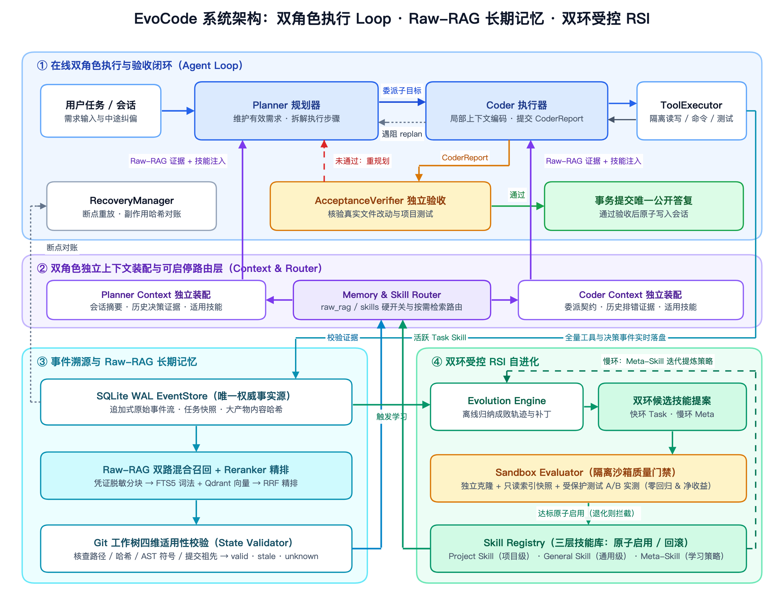
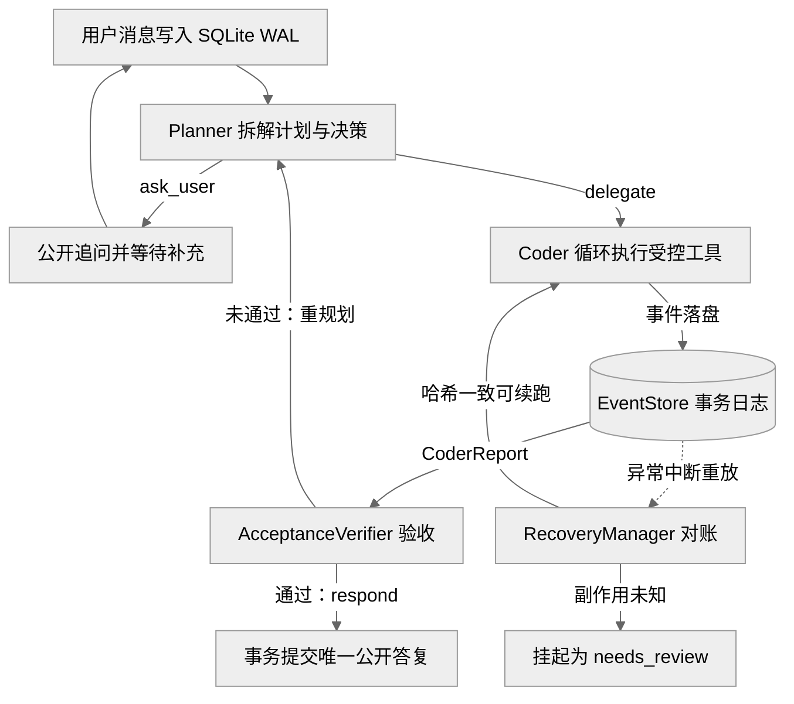
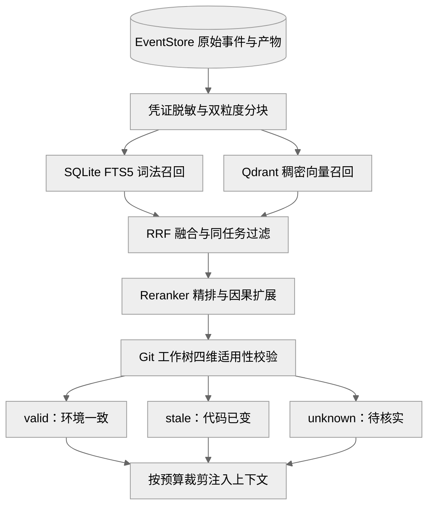
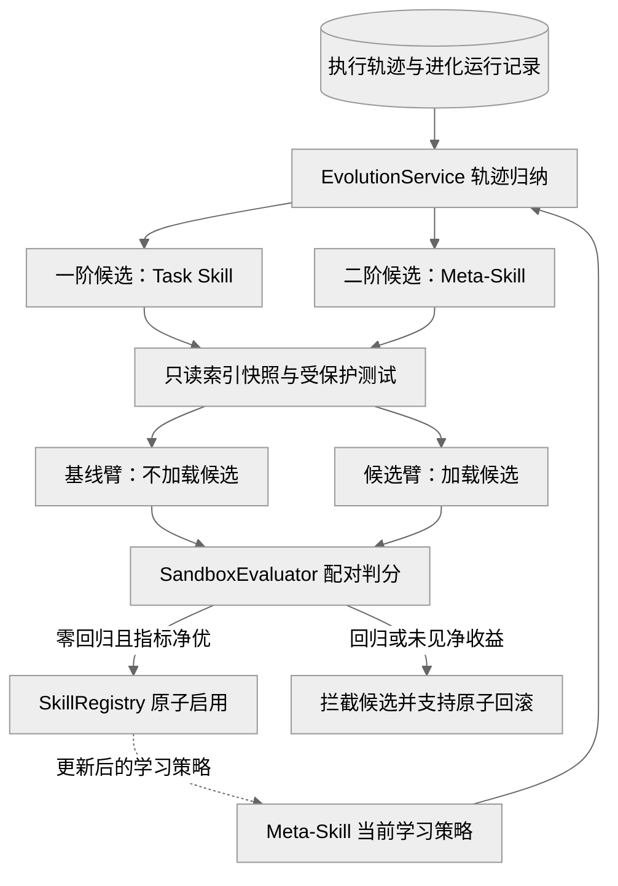

[返回主页](../README.md) · **系统架构** · [评测设计](benchmark-design.md) · [评测结果](benchmark-results.md)

# EvoCode 系统架构设计

EvoCode 面向长周期软件工程任务，构建可断点恢复、可证据追溯、可受控自进化的本地编码智能体。底层模型适配层（`ModelClient`）统一接入**兼容 OpenAI 接口的推理模型 / 向量与精排服务**，在不训练底座模型权重的前提下实现跨会话经验复用与技能迭代。

---

## 1. 架构总览与设计原则

系统遵循四条核心工程原则解耦运行边界：
- **事实与上下文分离**：`EventStore` 追加式持久化全量原始事实；模型上下文仅按预算装配当前决策所需投影。
- **原始记忆与抽象技能分离**：`Raw-RAG` 还原历史真实报错与补丁证据；`Skill` 沉淀可复用的结构化排错与开发规程。
- **在线执行与离线进化分离**：`Planner–Coder` 专注当前任务闭环；`EvolutionService` 异步归纳经验，不阻塞在线工具调用。
- **核心能力按需可插拔**：长期记忆、技能注入与自进化均具备独立硬门禁开关，关闭后基础执行引擎仍可无损独立运行。



| 工程核心痛点 | 架构解法 | 对应代码模块 |
| :--- | :--- | :--- |
| **长上下文漂移与注意力稀释** | 双角色隔离可见消息流，按独立预算动态装配、裁剪并生成无损会话摘要 | `src/evocode/context/assembler.py` (`ContextAssembler`)、`src/evocode/token_budget.py` (`TokenBudgetLedger`) |
| **跨会话遗忘与摘要丢失细节** | 基于 SQLite WAL 追加式记录全量原始执行事件与外部产物，按需检索真实证据 | `src/evocode/persistence/store.py` (`EventStore`)、`src/evocode/memory/service.py` (`MemoryService`) |
| **中断续跑引发重复外部副作用** | 重放未决工具事件并对账文件哈希，无法确认副作用时安全挂起等待人工裁决 | `src/evocode/agent/recovery.py` (`RecoveryManager`)、`src/evocode/agent/tools.py` (`UncertainToolExecution`) |
| **历史修复经验随代码演进过期** | 召回后结合当前 Git 工作树校验路径、内容哈希、语法符号与提交祖先关系 | `src/evocode/memory/service.py` (`MemoryService`)、`src/evocode/contracts.py` (`EvidenceRef`) |
| **经验难沉淀且提炼策略固化** | 一阶 `Task Skill` 沉淀项目与通用经验，二阶 `Meta-Skill` 持续优化学习策略 | `src/evocode/evolution/service.py` (`EvolutionService`)、`src/evocode/skills/registry.py` (`SkillRegistry`) |
| **自进化引入幻觉或质量退化** | 在独立克隆仓库、只读基线快照与受保护验收测试下执行 A/B 配对门禁实测 | `src/evocode/sandbox/evaluator.py` (`SandboxEvaluator`)、`src/evocode/agent/verification.py` (`AcceptanceVerifier`) |

```text
src/evocode/
├── app.py / api.py / cli.py  # 统一应用装配入口、HTTP 服务接口与命令行交互入口
├── config.py / llm.py        # 运行态配置解析快照、兼容 OpenAI 接口的模型客户端封装
├── contracts.py              # 跨模块强类型契约（PlannerDecision、CoderReport、EvidenceRef 等）
├── token_budget.py           # TokenBudgetLedger 角色级上下文与任务级模型开销计量账本
├── redaction.py              # 敏感密钥、令牌与凭据在入库索引及外发前的统一脱敏器
├── agent/                    # AgentController、Planner、Coder、ToolExecutor、AcceptanceVerifier、RecoveryManager
├── context/                  # ContextAssembler 双角色独立上下文实时重建与无损会话压缩
├── persistence/              # EventStore 基于 SQLite WAL 的事务型事件溯源、状态投影与产物管理
├── memory/                   # MemoryService 双粒度分块、FTS5 + Qdrant 混合检索、精排与工作树校验
├── skills/                   # SkillRegistry 项目级/通用级/元级技能存储、触发词匹配、原子发布与回滚
├── evolution/                # EvolutionService 轨迹归纳、提案结构化校验与双环 RSI 编排
└── sandbox/                  # SandboxEvaluator 独立 Git 克隆、只读快照备份与配对 A/B 验收评估
```

| 正交功能开关 | 开启时行为 | 关闭时硬门禁保障 |
| :--- | :--- | :--- |
| `raw_rag.enabled` | 按需执行混合召回、精排与工作树校验，通过独立上下文装配向 `Planner` 与 `Coder` 注入原始历史证据 | 检索路由返回 `memory_disabled`、禁用 `memory_search` 工具并清空上下文历史证据槽位 |
| `skills.enabled` | 任务启动锁定技能快照，按触发词匹配将适用 `Task Skill` 同时注入 `Planner` 与 `Coder` | `SkillRegistry` 跳过候选匹配与上下文注入，隔离历史抽象经验对当前推理的影响 |
| `evolution.enabled` | 允许在任务后或累计阶段触发离线轨迹归纳、沙箱实测与候选技能晋升 | 阻断离线进化提案与外部进化模型请求，在线 `Planner–Coder` 与事件落盘照常运行 |

---

## 2. Planner–Coder 双角色执行与断点恢复闭环

`AgentController` 将软件工程任务解耦为**全局规划验收**与**局部工具执行**两套循环：二者可对接同一兼容 OpenAI 接口的推理模型，但绝不共享累积对话列表。所有消息消费、计划推进与工具调用均在 SQLite WAL 事务内落盘，配合独立验收与副作用对账实现高可靠闭环。



| 对比维度 | `Planner` (`agent/planner.py`) | `Coder` (`agent/coder.py`) | `AgentController` 协同与门禁 (`agent/controller.py`) |
| :--- | :--- | :--- | :--- |
| **上下文视角** | 会话消息、有效需求（`CurrentRequirements`）、压缩摘要、汇报与验收结果 | 锁定有效需求的委派单（`ExecutionAssignment`）、局部代码、完整工具交互对及匹配技能 | 每轮推理前由 `ContextAssembler` 从持久化存储实时组装，杜绝陈旧内存状态干扰 |
| **工具权限** | 无直接文件读写或命令执行权限，专注需求维护、步骤编排与交付审查 | 受工作区路径边界约束的 `read_file`、`edit_file`、`run_command`、`run_tests`、`memory_search`、`replan` | `ToolExecutor` 拦截越界路径与 `.git` 目录修改，容器模式下仅挂载受控工作区目录 |
| **输出契约** | 结构化 `PlannerDecision`（`delegate` / `ask_user` / `respond`）与 `RequirementsProposal` | 结构化工具调用请求，或阶段完成时提交 `CoderReport`（变更文件、验证摘要、阻塞原因） | 未通过 `AcceptanceVerifier` 交付物核验与适用项目测试前，禁止发布最终答复 |
| **预算控制** | `TokenBudgetLedger` 独立统计输入额度；超限时自动压缩旧对话并保留原始事件 | 仅保留调用与结果配对完整的原子消息组，自动检测重复只读探测（`execution_stop.py`）止损 | 统一实施步数上限、工具超时、重规划阈值，并在工具边界消费中途追加指令（`redirect`） |
| **断点恢复** | 依据持久化会话序号与已接受需求快照直接恢复规划，不重跑已完成阶段 | `RecoveryManager` 自动补齐未闭合的工具结果槽位，防止残缺上下文导致模型调用报错 | 对未决 `edit_file` 比对前后内容哈希自动判定成败；未知命令副作用强制转入 `needs_review` |

- **原子状态推进**：用户消息消费回执（`user.message.consumed`）、状态变更与事件追加在同一 `BEGIN IMMEDIATE` 事务中提交。
- **真实交付核验**：`AcceptanceVerifier` 依据实际工具写入事件核对 `DeliveryTarget` 创建/修改/删除结果，并自动发现或运行项目测试，杜绝模型虚报完成。

| SQLite 核心存储对象 | 持久化内容（`src/evocode/persistence/store.py`） | 一致性与恢复职责 |
| :--- | :--- | :--- |
| `sessions` / `conversation_messages` | 会话元数据、递增消息序号、压缩摘要游标与工作状态 | 作为 `ContextAssembler` 重建对话视图的唯一权威事实源 |
| `tasks` / `events` | 任务确定性状态机快照，以及按 `(session_id, seq)` 严格递增的追加式原始事件 | 支撑崩溃后状态重放、未决工具调用识别与跨会话审计追溯 |
| `artifacts` / `memory_chunks` | 大体积工具输出、代码补丁文件及脱敏后的检索分块与全文索引 | 避免巨型日志撑爆上下文，同时保留可验证的内容哈希引用 |
| `skills` / `skill_versions` / `evaluations` | 技能注册指针、不可变技能内容文件、进化运行日志与沙箱配对评估报告 | 支撑线上无锁读取活跃技能、门禁凭证校验及一键原子回滚 |

---

## 3. Raw-RAG 混合长期记忆与适用性校验

`MemoryService` 直接面向跨会话原始事件与大体积日志产物建立词法与向量双索引，并在召回后针对当前代码库状态执行确定性校验，防止过期修复方案产生误导。



| 检索与校验环节 | 核心机制（`src/evocode/memory/service.py`） | 工程保障目标 |
| :--- | :--- | :--- |
| **脱敏与双粒度分块** | 经 `redaction.py` 剥离密钥令牌；并行生成单事件滑动窗口（`event`）与「故障 → 补丁 → 验证通过」因果片段（`episode`） | 兼顾局部报错匹配与完整排错链路还原，确保敏感凭据不入索引 |
| **双路召回与融合** | 并行检索 `SQLite FTS5`（BM25 精确匹配异常码、函数名）与 `Qdrant` 稠密向量（语义相似问题），经倒数秩融合（RRF）合并并剔除当前任务事件 | 结合精确符号检索与模糊语义召回优势，向量服务异常时可平滑降级至纯词法模式 |
| **精排与上下文扩展** | 调用兼容 OpenAI 接口的向量与精排服务重排候选；单事件自动拼接相邻有效观察，因果片段提取故障、补丁与终态验证锚点 | 在有限上下文预算内保留高密度“报错原因 + 实际改动 + 验证结果”证据链 |
| **工作树适用性校验** | 在当前 Git 工作树实时核查四项指标：① 文件路径存在性与内容哈希、② 依赖清单指纹（`pyproject.toml`、`package.json` 等）、③ AST 函数/类符号定义、④ `git merge-base --is-ancestor` 提交祖先关系 | 精准识别文件重命名、函数删除、依赖变更或跨分支演进造成的经验失效 |
| **三态标注与硬门禁** | 每条 `EvidenceRef` 标注 `valid`、`stale` 或 `unknown` 并作为非指令参考证据注入；当 `raw_rag.enabled=false` 时，检索入口、`memory_search` 工具与 `ContextAssembler` 三处同步硬阻断 | 遇到 `stale` / `unknown` 证据强制模型核查现行源码；关闭开关时彻底阻断历史通道与缓存泄漏 |

---

## 4. 双环受控 RSI 技能自进化（Task Skill & Meta-Skill）

系统在不触碰模型参数与核心安全规则的前提下，构建双时间尺度递归自改进（RSI）闭环：一阶快循环提炼具体编码技能 `Task Skill`，二阶慢循环优化提炼方法本身 `Meta-Skill`。所有候选技能均须通过 `SandboxEvaluator` 的隔离配对实测后，方可由 `SkillRegistry` 原子启用。



| 分层对比维度 | 一阶快循环：`Task Skill`（项目级 `project` / 通用级 `general`） | 二阶慢循环：`Meta-Skill`（学习策略演化 `meta`） |
| :--- | :--- | :--- |
| **演化对象与状态** | 提炼特定仓库约定（绑定 `scope_id`）或跨仓库通用排错规程，沉淀结构化操作步骤与适用边界 | 从内置**默认学习策略**演进为**更新后的学习策略**，改进轨迹筛选、去重复用与经验抽象准则 |
| **学习证据输入** | `EventStore` 原始任务轨迹、代码补丁（`code.patch`）、测试输出及现有活跃技能库 | 历次 `evolution_runs` 提案成败记录、沙箱门禁诊断及技能加载后的真实任务反馈 |
| **允许操作范围** | 支持 `CREATE`、`REVISE`、`MERGE`、`GENERALIZE`、`DEPRECATE`，强制校验来源事件引用 | 仅支持策略新增与修订，严禁执行合并、废弃，且不可越权修改工具权限与沙箱判分规则 |
| **运行期消费方** | 任务启动时锁定活跃技能快照，按触发词匹配并受控注入 `Planner` 与 `Coder` 上下文 | 离线进化期由 `EvolutionService` 加载，指导兼容 OpenAI 接口的推理模型生成一阶技能提案 |
| **沙箱隔离实测** | `SandboxEvaluator` 创建无硬链接独立 Git 克隆、只读 SQLite/Qdrant 基线快照与工作区外只读受保护验收测试，同任务同预算对比基线臂与候选臂 | 在只读基线快照上分别用当前学习策略与候选策略派生同仓库一阶技能，强校验双臂派生技能均真实注入 `Coder` 模型上下文后执行配对实测 |
| **启用与回滚契约** | 必须在受保护验收测试上全部通过、对基线已通过用例**零回归**，且通过数提升或目标开销净下降；单事务原子切换 `active`，支持 `rollback` / `rollback_merge` 精确回滚 | 除满足全部通过、零回归与目标指标净优外，若缺失同仓库可比配对或上下文注入证据不完整则一律拦截为 `needs_review`，杜绝无效策略上线 |

- **防篡改验收基准**：沙箱实测采用脱离待测工作区的只读受保护测试文件（Oracle Acceptance），运行容器无法篡改验收脚本自证通过。
- **并发与事务隔离**：评估期间线上活跃技能指针保持锁定；晋升或合并回滚均在 `SkillRegistry` 单事务内核验前置状态后原子完成，保障执行期一致性。
