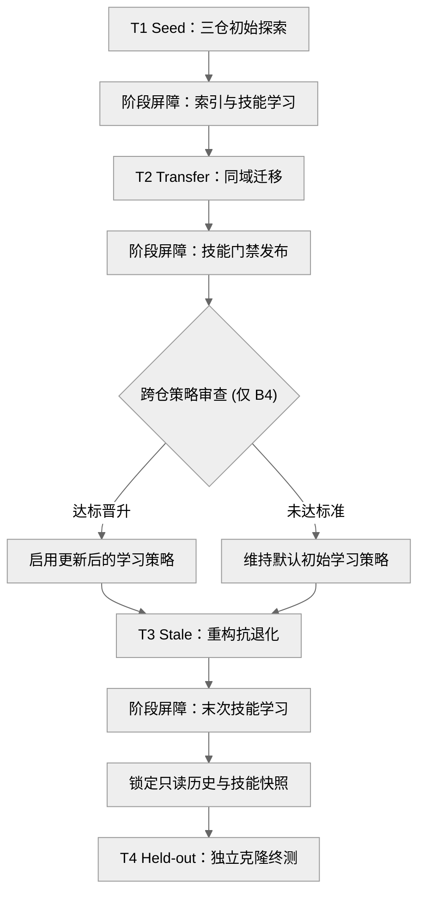
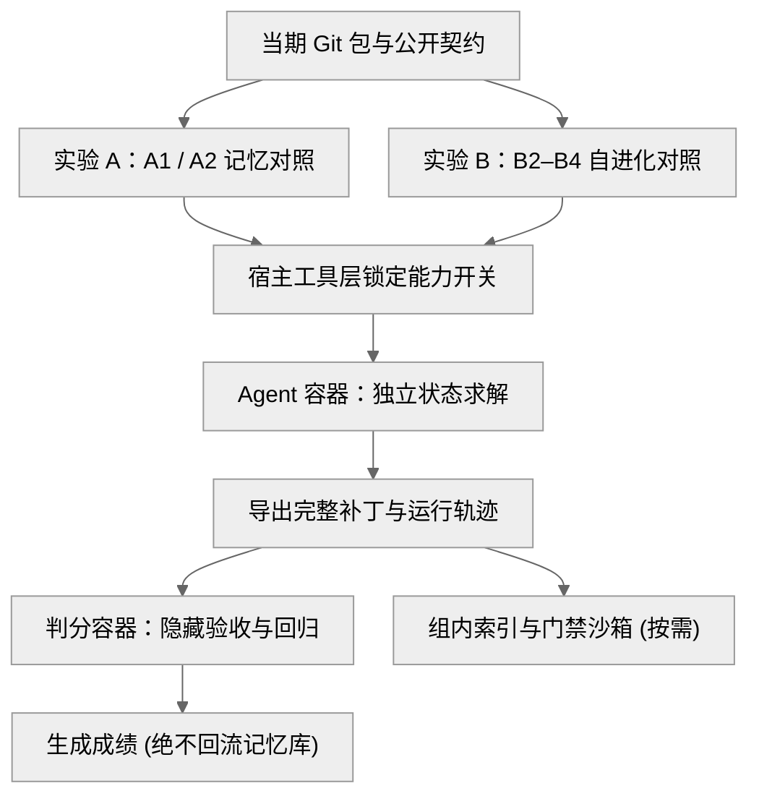
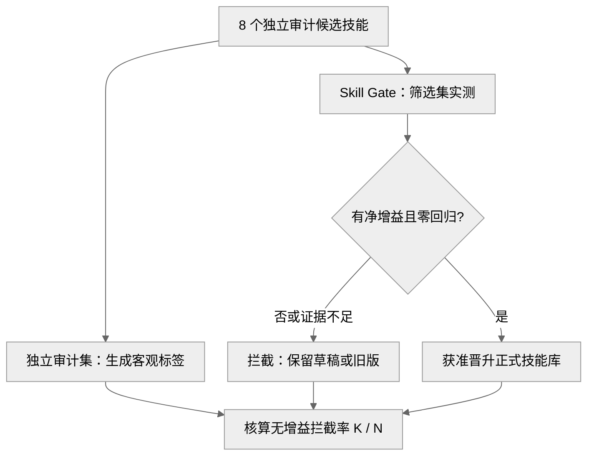

[返回主页](../README.md) · [系统架构](architecture.md) · **评测设计** · [评测结果](benchmark-results.md)

# EvoCode 评测设计：时序演化基准与正交消融协议

传统单题独立代码基准在每道题结束后即销毁上下文与状态，无法评估具备长期记忆与持续自进化（RSI）能力的编码智能体。EvoCode 为此设计了基于**四阶段时序任务链 + 正交对照分组 + 独立沙箱门禁**的可执行工程基准（机器可读协议契约见 [`benchmark/configs/protocol.yaml`](../benchmark/configs/protocol.yaml)）：

| 对比维度 | 传统单题静态基准 | EvoCode 时序演化基准 |
| :--- | :--- | :--- |
| **状态生命周期** | 单题即抛，任务间无历史轨迹或经验留存 | 沿阶段屏障按序累积真实执行轨迹与受控演进技能 |
| **代码环境演进** | 单一静态快照，无法模拟业务重构与接口变迁 | 真实本地 Git 演进链，专门设置重构阶段检验旧经验失效 |
| **自进化副作用监控** | 仅看当次补丁成败，不考核策略污染与能力退化 | 引入独立沙箱门禁、固定历史回归重放与外部标签审计 |
| **成本核算边界** | 仅统计单次在线推理开销 | 区分在线解题成本、后台提炼与门禁摊销成本及同题配对成本 |

---

## 1. 评测核心问题与三项目题集矩阵

本基准旨在通过严格受控的对照实验回答两个核心科学问题：

1. **长期记忆（Raw-RAG）是否真正带来跨阶段与抗代码变更净收益？**
   在相同模型、相同代码起点与一致的只读公共历史下，开启原始历史证据检索能否提升后续同域任务解决率、缩短定位路径，并在代码重构后准确核验旧线索的有效性？
2. **持续自进化（RSI）与质量门禁能否带来可迁移的正净收益并拦截劣质技能？**
   在保持 Raw-RAG 开启的前提下，一阶任务技能（Task Skill）提炼与二阶跨仓学习策略（Meta-Skill）演进能否带来可泛化的净收益，且由质量门禁（`Skill Gate`）可靠拦截有害、过期或无增益候选技能？

### 三项目 × 四阶段题集矩阵

题集覆盖 3 个彼此独立的标准库 Python 业务仓库，每个仓库包含 4 个按序演化的真实修复任务，共 **12 道唯一主任务**：

| 业务仓库 | 领域与核心业务契约 | `T1 Seed`（初始探索） | `T2 Transfer`（同域迁移） | `T3 Stale`（重构抗退化） | `T4 Held-out`（留出终测） |
| :--- | :--- | :--- | :--- | :--- | :--- |
| [**`repo_api`**](../benchmark/scenarios/repo_api/README.md) | 库存服务 JSON 接口与状态事务 | 预约数量边界校验与失败编号回滚 | 含损退货多下限校验与可用件入库 | 错误模块与校验函数改名后嵌套暂存 | 批量预约全量校验与重复 SKU 事务隔离 |
| [**`repo_cli`**](../benchmark/scenarios/repo_cli/README.md) | 发布命令行工具与多源配置覆盖 | 发布重试次数边界与非零退出契约 | 多格式配置与子命令并发参数迁移 | 配置加载接口改版后的来源优先级保持 | 多参数与多配置源交错时的组合边界 |
| [**`repo_data`**](../benchmark/scenarios/repo_data/README.md) | 账务与仓储多流程数据管线 | 销售汇总报表的金额精度边界修复 | 出库清单未称重记录与状态表达 | 合作方对账输入格式与字段表示迁移 | 月结导入多源字段组合与兼容性处理 |

### 评测整体规模核算

| 评测构成 | 规模配置 | 计量与隔离说明 |
| :--- | :--- | :--- |
| **主评测题集** | **12 道真实修复任务** | 3 个业务仓库 × 4 个阶段；每题具备固定基线代码起点、阶段本地 Git 历史与隐藏验收/回归测试 |
| **主实验运行位** | **54 个正式运行位** | 实验 A（3 仓 × 3 阶段 × 2 组 = 18 位）+ 实验 B（3 仓 × 4 阶段 × 3 组 = 36 位），单次正式运行不挑优 |
| **独立门禁审计集** | **8 个候选技能审计位** | 覆盖重复、过期、潜在有害、潜在有益 4 类各 2 个样本，独立于 12 道主任务单独核算门禁拦截率 |

---

## 2. 四阶段时序演化任务链（`T1 → T2 → T3 → T4`）

每个仓库的四道任务处于同一条本地 Git 演化链上，但**每阶段均采用预设的固定代码快照作为起点**，防止前序任务的偶发成败改变后续题目的初始代码难度；跨阶段传递的仅为组内累积的历史事件索引与获准发布的技能。

### 四阶段职责与防过拟合设计

| 阶段 | 任务设计特征 | 核心检验能力 | 学习检查点与防过拟合约束 |
| :--- | :--- | :--- | :--- |
| **`T1 Seed`** | 初始隐蔽业务边界缺陷或状态回滚漏洞 | 冷启动定位与修复能力，生成真实原始执行轨迹 | 严禁预置参考答案；三仓波次全部终止后执行增量索引，进化组触发首次任务技能提炼 |
| **`T2 Transfer`** | 同业务机制但跨路由、跨子命令或跨流程的新问题 | Raw-RAG 历史证据复用与一阶 Task Skill 同域迁移 | 三仓任务技能门禁发布落盘后，`B4` 固定触发唯一一次跨仓学习策略审查 |
| **`T3 Stale`** | 预设模块迁移、函数改名或接口改版后的相似故障 | 代码状态核验（`state_validator`），避免盲目照搬过期修复 | 提供真实阶段本地 Git 提交链供核验路径与符号；阶段末按当前生效策略完成末次技能学习 |
| **`T4 Held-out`** | 多来源交错、批量事务等高复杂度留出新题 | 演化体系对未知新任务的终局泛化能力 | **严格防过拟合**：提前锁定组状态快照，三仓各自从只读快照独立克隆运行，不学习、不回写、不参与任何门禁筛选 |

- **阶段绑定跨仓审查规则**：`B4` 在 `T2` 三仓任务技能门禁全部结束后固定触发一次跨仓策略复盘，但**只强制审查、不强制晋升**——仅当候选新策略通过独立 Meta 门禁实测时才切换为更新后的学习策略并指导 `T3` 后的学习；否则如实维持默认初始学习策略。

---

## 3. 正交对照实验矩阵与防泄漏隔离机制

为彻底解耦“长期记忆检索”与“技能持续进化”两类变量，评测拆分为两套正交对照实验，并在容器边界与宿主工具层实施硬隔离：

### 五组正交开关矩阵

| 实验与组别 | Raw-RAG | Task Skill | 学习策略（Meta-Skill） | 初始状态与评测范围 | 核心对照目标 |
| :--- | :---: | :---: | :---: | :--- | :--- |
| **实验 A：`A1`** | 关闭 | 关闭 | 关闭 | 共享截至前序阶段的只读公共历史快照；评测 `T2/T3/T4`（**9 题/组**） | 无长期记忆检索、无技能注入的纯当前会话基线 |
| **实验 A：`A2`** | **开启** | 关闭 | 关闭 | 与 `A1` 同步配对克隆一致的只读公共历史与索引（**9 题/组**） | 对比 `A2 vs A1`：关闭技能与自进化，单测 Raw-RAG 跨阶段净收益 |
| **实验 B：`B2`** | 开启 | 静态基线（不学习） | 默认初始学习策略（不触发） | 一致的空任务技能库与默认初始学习策略起步；连续运行 `T1→T4`（**12 题/组**） | 具备长期记忆但不触发任何技能学习的静态对照基线 |
| **实验 B：`B3`** | 开启 | **随阶段自进化** | 锁定默认初始学习策略 | 与 `B2` 一致起步，在 `T1/T2/T3` 阶段末提炼并门禁发布任务技能（**12 题/组**） | 对比 `B3 vs B2`：单测一阶 Task Skill 持续自进化收益 |
| **实验 B：`B4`** | 开启 | **随阶段自进化** | **允许更新学习策略** | 与 `B3` 一致起步，`T2` 后触发跨仓策略审查，达标则启用更新后的学习策略（**12 题/组**） | 对比 `B4 vs B3`：单测跨仓二阶策略自进化对后续学习的增益 |

### 四条公平性与防泄漏红线

1. **阶段 Git 包剥离未来提交**：每阶段构建独立的本地 Git 压缩包，仅保留截至当期 `HEAD` 的可达对象与合法历史祖先，物理剔除未来阶段的分支引用与底层对象库，防止通过 `git log` 或对象扫描窥探未来代码。
2. **私有隐藏验收与 Agent 容器物理隔离**：Agent 容器仅挂载当期公开工作区，宿主工具层硬性拦截已关闭能力（不靠提示词软约束）；`private/` 下的隐藏验收测试、固定回归重放与参考修复仅在同波次 Agent 全部终止后挂载至独立干净的判分容器。
3. **判分日志绝不回流记忆或技能库**：主任务仅在**隐藏验收测试与固定回归测试同时通过**时记为解决（不采信模型自评或公开测试）；私有判分日志、报错详情及 `T4` 成绩严禁写入长期记忆、门禁筛选或进化反馈链路。
4. **统一阶段屏障与预算上限**：正式评测遵循阶段屏障并发调度（`phase_barrier`），三仓同波次任务全部终止后按固定仓库顺序归并轨迹、增量索引并顺序发布门禁技能；所有组严格共享单题限时（600 秒）、工具步数上限（80 步）、上下文窗口与总 Token 账本预算。

| 状态隔离维度 | 受控实现机制 | 防污染作用 |
| :--- | :--- | :--- |
| **实验 A 配对状态** | 独立公共采集流预先生成只读历史快照；`A1/A2` 各克隆独立状态与工作区同步派发 | 确保两组面对完全一致的历史上下文，仅检索开关不同 |
| **实验 B 组间与仓间状态** | `B2/B3/B4` 各持独立 SQLite 克隆库；同组三仓按 `repository_id` 隔离记忆与项目级技能作用域 | 兼顾跨仓二阶策略复盘与组间零串扰、仓间技能不越界 |
| **全链路可复现指纹** | 每次运行固化代码快照、历史快照、索引内容、技能注册表及容器镜像的哈希摘要 | 保证任意单次成绩均可回溯至确定性的输入状态与运行边界 |

---

## 4. 核心评价指标体系（5 + 1 核心指标与配对成本口径）

评测采用 **5 项主实验指标 + 1 项独立门禁审计指标**，全面衡量解决率、执行与进化全链路成本、跨阶段迁移与防退化能力：

| 序号与核心指标 | 计算口径 | 设计意图与评估重点 |
| :--- | :--- | :--- |
| **1. 任务解决率**（`Pass@1 / Solve Rate`） | 单次运行后隐藏验收测试与固定回归测试同时通过的任务数 / 有效判分数（同步披露计划分母与覆盖率） | **主生产力指标**：客观衡量真实修复任务的一次通过能力 |
| **2. 单题平均工具调用步数**（`Tool Calls per Solved Task`） | 已解决任务的在线工具调用总数 / 已解决任务数（同步报告成功题数） | **路径效率指标**：衡量定位与修复路径是否更短、更少盲目试错 |
| **3. 单题全链路 Token 成本**（`Total Tokens per Solved Task`） | 分角色记录 Planner、Coder 与 Evolution 用量，区分**在线解题每解成本**与**含后台提炼/门禁实测的全链路摊销每解成本** | **真实经济性指标**：检验自进化后台提炼与沙箱门禁开销能否被解题收益抵消 |
| **4. 技能迁移成功率**（`Skill Transfer Success`） | 未参与对应技能生成的迁移任务（重点考核 `T2 + T4` 迁移集与 `T3 + T4` 后半程任务）的隐藏验收通过率 | **泛化价值指标**：验证学到的技能是否具备跨任务迁移价值而非死记原题 |
| **5. 历史功能回归率**（`Regression Rate`） | 在固定历史回归重放题集上，基线状态可通过而技能更新后失败的任务比例 | **安全底线指标**：监控主任务修复或技能演进是否破坏既有历史功能 |
| **6. 无增益技能拦截率**（`NSRR, Non-beneficial Skill Rejection Rate`） | 在独立外部标签门禁审计集上，被外部审计判定为无增益或有害且被 `Skill Gate` 拦截的候选比例 $K / N$ | **防劣化门禁指标**：单独验证 `Skill Gate` 拦截有害、过期或重复无增益候选技能的能力 |

### 独立沙箱门禁审计机制（`NSRR`）

为避免使用门禁自身的筛选结果去“自证”门禁有效，基准在 12 道主任务之外独立设置 8 个候选技能审计位，将门禁决策筛选集与外部标签审计集物理隔离：

$$\mathrm{NSRR} = \frac{K}{N} \times 100\% = \frac{\text{外部独立审计判定无增益或有害、且被 Skill Gate 拦截的候选数}}{\text{外部独立审计判定无增益或有害的候选总数}} \times 100\%$$

| 预设审计候选类别（共 8 个） | 样本数 | 典型风险场景 | 预期门禁行为与报告口径 |
| :--- | :---: | :--- | :--- |
| **重复候选 / 无明显收益** | 2 | 既有流程的同义改写，未减少错误或步数 | 拒绝晋升或保留草稿，计入无增益拦截分子 $K$ |
| **过期候选** | 2 | 指向已迁移路径或已废弃接口参数 | 拦截或限制作用域，防止误导重构后代码修改 |
| **潜在有害候选** | 2 | 吞没异常或破坏幂等性，引发固定回归失败 | 严格拦截，阻断回归缺陷污染正式技能库 |
| **潜在有益候选** | 2 | 在独立审计题上带来可复现的真实提升 | **应当允许晋升**；单独披露放行/误拒数，防止“全拦截”策略刷出虚高 `NSRR`（若 $N=0$ 则记 `N/A`） |

### 补充统计口径：共同成功题目配对成本（`Paired-Solved Cost`）

由于 `Tool Calls / Tokens per Solved Task` 仅对各组自身解决的题目求均值，当某组额外解决了高难度题目时，高难题本身更长的探索轨迹会拉高其单题均摊成本，造成**存活偏差（Survivorship Bias）**。为此评测补充**共同成功题目配对成本**口径：

- **同题交集对比**：针对任意两组对照（如 `A1 vs A2`、`B2 vs B3`、`B3 vs B4`），仅在**两组均成功解决的相同题目交集**上对比平均工具调用步数与在线 Token（交集为空时记为 `N/A`），消除题目难度不对等带来的偏差。
- **全量消耗并列披露**：配对成本不替代整体解决率，报告同步列出每组全部计划任务（含失败任务）的在线总消耗与后台自进化总账本，完整呈现真实资源投入。

> [!IMPORTANT]
> **严谨核账与样本边界**：54 个主实验运行位源自 12 道唯一主任务的多组对照，报告不将运行位数量等同于独立题量；运行超时或单题预算耗尽统一计为失败（`failed`），容器或底层环境异常单独标记为未验证（`unverified`）并完整披露有效判分覆盖率，绝不挑选或覆盖失败记录。
