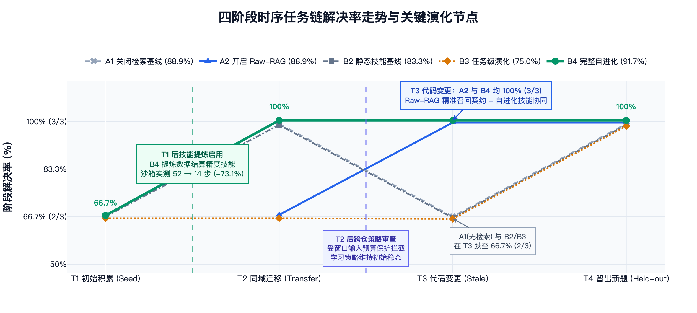
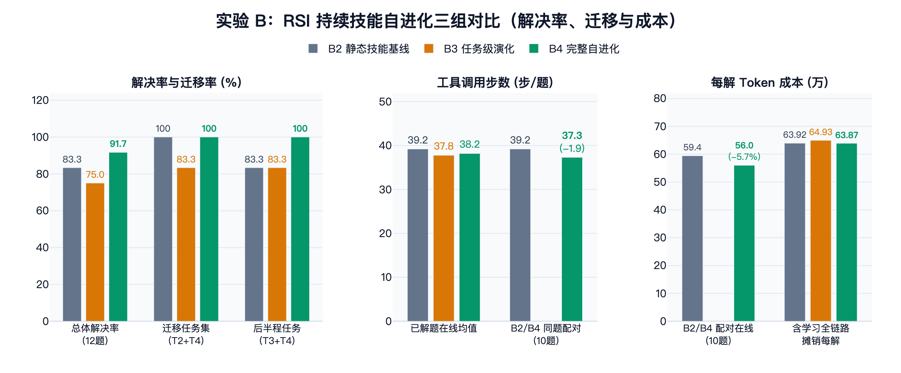
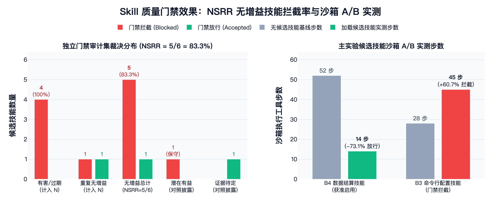

[返回主页](../README.md) · [系统架构](architecture.md) · [评测设计](benchmark-design.md) · **评测结果**

# EvoCode 基准评测结果与能力验证报告

本文档呈现 EvoCode 在三个独立 Python 业务仓库（[`repo_api`](../benchmark/scenarios/repo_api/README.md) 幂等预留服务、[`repo_cli`](../benchmark/scenarios/repo_cli/README.md) 多源配置工具、[`repo_data`](../benchmark/scenarios/repo_data/README.md) 账务结算管线）× 四阶段时序任务链（**12 道真实修复任务、54 个主实验运行位 + 8 个独立门禁审计位**）上的全量隔离容器实测结果。

---

## 1. 核心指标总览与时序演化走势

全部 54 个主实验运行位 **100% 完成独立隐藏验收与固定回归核验（零缺测）**，总体解决 **46/54（85.2%）**，全实验 **历史回归率 `Regression Rate = 0.0%`（0/54）**；独立门禁审计集 **无增益技能拦截率 `NSRR = 83.3%`（5/6，其中 4 个有害/过期技能 `100%` 拦截）**。

### 五组核心评价指标总表（`5 + 1` 核心指标 + 同题配对成本）

| 实验组 | 能力配置 | 任务解决率 (`Pass@1`) | `T3` 重构期解决率 | 迁移成功率 (`T2+T4` / `T3+T4`) | 已解题在线均值（步数 / Tokens） | 全链路摊销成本（步数 / `Total Tokens`） | 同题配对净变化 (`Paired-Solved`) & 技能启用 | 历史回归率 (`Regression`) |
| :--- | :--- | :---: | :---: | :---: | :---: | :---: | :--- | :---: |
| **`A1`** | 关闭 Raw-RAG、无技能 | 88.9%（8/9） | 66.7%（2/3） | — | **38.6 步** / 44.6 万 | 44.8 步 / 486,558 | 实验 A 基线（7 题交集） | **0.0%** |
| **`A2`** | **开启 Raw-RAG**、无技能 | 88.9%（8/9） | **100.0%（3/3）** | — | 41.9 步 / 62.0 万 | **43.4 步** / 627,775 | **`T3` 阶段 `+33.3%`**；全任务摊销 `-1.4` 步 | **0.0%** |
| **`B2`** | 静态技能基线（不学习） | 83.3%（10/12） | 66.7%（2/3） | 100.0% / 83.3% | 39.2 步 / 59.4 万 | 44.6 步 / 639,245 | 实验 B 基线（10 题交集） | **0.0%** |
| **`B3`** | 一阶任务演化 `Task RSI` | 75.0%（9/12） | 66.7%（2/3） | 83.3% / 83.3% | 37.8 步 / 51.8 万 | 56.7 步 / 649,339 | 门禁拦截唯一退化提案（`0/1` 启用，零污染） | **0.0%** |
| **`B4`** | **完整自进化 `Task+Meta`** | **91.7%（11/12）** | **100.0%（3/3）** | **100.0% / 100.0%** | 38.2 步 / 57.9 万 | 48.6 步 / **638,702** | **较 `B2` 少 `1.9` 步、省 `5.7%` 在线 Token**（`1/1` 启用） | **0.0%** |

> *注：全链路摊销成本已将未解任务开销及后台技能提炼、沙箱门禁验证 Token 全部计入并摊销至每道已解决任务；独立门禁审计指标 **`NSRR = 83.3%`（5/6）**。*

---

## 2. Raw-RAG 能力提升验证：重构抗退化与隐式契约召回

实验 A 在共享一致的只读公共历史且彻底关闭技能与自进化的前提下，检验 `Raw-RAG` 在跨阶段开发与代码重构场景下的净价值：

- **混合检索 100% 有效召回**：`A2` 在 8/9 评测题上按需触发 **13 次双路混合检索（`13/13` 100% 成功召回）**，累计命中 `65` 条稠密向量候选与 `45` 条 FTS5 符号候选，经精排与工作树校验返回 `39` 条有效证据引用（`A1` 全程严格为 `0`）。在关键词全文命中为 `0` 的跨模块查询中，向量与精排通道依然成功补齐核心历史事件。
- **代码变更阶段（`T3 Stale`）解决率提升 `+33.3%`**：在模块改名与接口迁移最剧烈的 `T3` 阶段，`A2` 将解决率从无检索基线 `A1` 的 `66.7%`（2/3）拉升至 **`100.0%`（3/3）**，并将全任务摊销步数从 `44.8` 步降至 **`43.4` 步（`-1.4` 步）**。
- **微观因果实证（`repo_data` 合作方对账接口升级）**：全场 54 个运行位中，**开启 Raw-RAG 的全部四组（`A2 / B2 / B3 / B4`）在该题达成 `4/4（100%）` 通过，唯独关闭检索的 `A1` 失败**：

| 对照维度 | `A1`（关闭 Raw-RAG，无历史记忆） | `A2`（开启 Raw-RAG，无技能辅助） |
| :--- | :--- | :--- |
| **历史检索与契约识别** | `0` 次检索；丢失前序阶段整数字符串代表分单位（`minor_unit`）及 `ROUND_HALF_UP` 舍入的隐式业务契约 | 2 次混合检索召回 **6 条前序真实修改与验证事件**，精准还原 `minor_unit` 与 `ROUND_HALF_UP` 结算契约 |
| **执行步数与验收裁决** | 49 步，**隐藏验收 `0/2` 失败**（金额换算与舍入断言双败） | **46 步**（少于 `A1`），**隐藏验收 `2/2` 与回归测试 `2/2` 一次满分通过** |

- **上下文权衡与模块互补**：在无需历史契约也能解出的常规题上，阅读原始历史片段会带来约 `+25.0%` 的在线 Token 增量（并偶发单题探查超时使 9 题总率持平）。这印证了系统双层设计的合理性：**由 Raw-RAG 在重构演进期提供底层原始证据兜底，再由 RSI 将高频规律压缩为轻量级结构化技能以降低推理负担。**

---

## 3. RSI 自进化与质量门禁验证：提效降本与防退化双闭环

实验 B 三组均开启 Raw-RAG，从一致的空任务技能库起步连续运行 `T1 → T4`，正反双向验证了“高质量技能复用提效降本”与“沙箱门禁阻断劣质演化”：

### 3.1 正向闭环：技能提炼使沙箱步数骤降 73.1%，实现端到端帕累托改进

`B4` 仅在冷启动首阶段 `repo_cli_seed` 未过，自学习闭环启动后的 **`T2 / T3 / T4` 九道任务取得 `9/9（100.0%）` 大满贯全胜**（整体解决率 **`91.7%`**，较静态基线 `B2` 提升 **`+8.3%`**，后半程 `T3+T4` 提升 **`+16.7%`**）：

| 演化闭环阶段 | `B4` 实测证据链（以 `repo_data` 账务管线为例） | 量化收益与验证结果 |
| :--- | :--- | :--- |
| **1. 轨迹提炼与沙箱实测** | `T1` 完成后自动提炼 `LedgerFlow Decimal Sales Precision` 八步精度规程，进入无网隔离沙箱 A/B 实测 | 门禁验收 `2/2` 全过，执行步数从无技能基线 **`52 步降至 14 步（-73.1%）`**，获准原子启用 |
| **2. 跨阶段持续注入复用** | 在后续 `T2`（出库清单）、`T3`（合作方对账重构）、`T4`（月结多源导入）自动匹配注入 `Planner` 与 `Coder` | 下游三阶段累计精准注入 **`92` 次**模型上下文，三阶段隐藏验收与累积回归 **`100%` 全过** |
| **3. 全链路成本净收益** | 后台学习与门禁验证仅耗费 `51,362` Tokens（占全组总消耗的 **`0.73%`**） | 10 道同题配对平均**少用 `1.9` 步、节省 `5.7%` 在线 Token**；含学习摊销每解总成本（**`638,702`**）**低于不学习的 `B2`（`639,245`）** |

### 3.2 负向防御：`Skill Gate` 在线阻断退化提案，独立盲测 `NSRR = 83.3%`

- **在线零污染拦截（解释 `B3` 表现）**：`B3` 在 `T1` 后提炼的候选技能在门禁沙箱实测中使步数从 `28` 步恶化至 `45` 步（`+60.7%`），被 `Skill Gate` 当场拦截（`0` 启用，线上技能库零污染，其与 `B2` 的 1 题分差纯属单轮无技能采样波动）。
- **独立盲测 100% 拦截有害技能**：在物理隔离的 8 候选盲测审计集中，**全部 4 个有害/过期退化技能（异常吞没、幂等破坏、废弃重试、旧时区偏移）实现 `4/4（100%）` 刚性拦截**，重复无增益候选拦截 `1/2`，总体无增益技能拦截率 **`NSRR = 5/6 = 83.3%`**，有力守护了全实验 **`0.0%` 历史功能回归率**。

---

## 4. 实验边界与局限

1. **长轨迹窗口预算保护**：部分长轨迹提炼与 `B4` 在 `T2` 后的跨仓策略审查因预估输入超出单窗口预算阈值而安全跳过，因此本次 `B4` 的实测增益来自**一阶 `Task Skill` 闭环与质量门禁协同**（而非二阶策略变更），后续可通过轨迹分层摘要进一步激活二阶策略迭代。
2. **单轮样本规模边界**：当前正式矩阵为 3 仓库 × 4 阶段共 54 次主运行（每组 9–12 题），单题容器探查超时仍会带来约 `8%–11%` 的单轮波动，后续可扩展更多仓库与多轮重复统计。

---

📂 **原始脱敏台账索引**：[54 题逐题判分明细表](../benchmark/reports/formal_summary/main_tasks.csv) · [分组指标汇总 CSV](../benchmark/reports/formal_summary/condition_metrics.csv) · [完整汇总报表](../benchmark/reports/formal_summary/summary.md)
